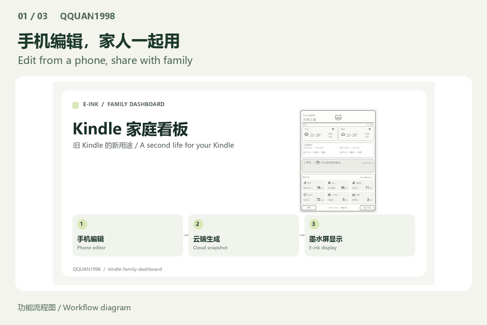
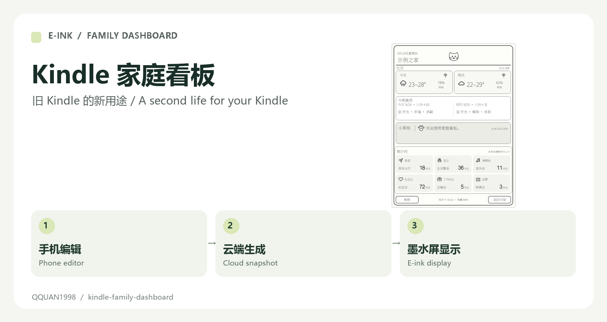
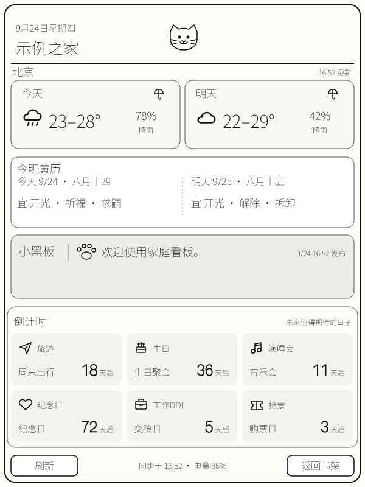

# Give an idle Kindle a new job

[简体中文](README.md) · [Visual tour](https://qquan1998.github.io/kindle-family-dashboard/) · [Report an issue](https://github.com/QQUAN1998/kindle-family-dashboard/issues)



> For owners of idle, compatible jailbroken Kindles. Preview locally before configuring cloud services. Device installation is a separate step.

<a id="quick-start"></a>

## Quick start

1. Clone the repository and install Node.js 24; run the commands below from its root.
2. Open the local URL printed by the server and append ?demo=1.
3. For device installation, follow the full guide with your own cloud environment and a compatible jailbroken Kindle.

```text
npm ci
npm run check
npx --yes serve dist/site
```

[Bilingual launch copy](docs/LAUNCH.md) · [Documentation changes](docs/UPDATES.md) · [Release checklist](docs/RELEASING.md)

---

# Kindle Family Dashboard

[简体中文 / bilingual details](README.md) · [Full installation guide](docs/INSTALL.en.md)



Turn a jailbroken Kindle into a low-power family display, edit it from a phone browser, and return to the original bookshelf whenever needed.

## On the screen



| Module | Contents |
| --- | --- |
| Weather | Today/tomorrow weather and rain probability for a selected city |
| Almanac | Solar/lunar dates and calculated suitable activities |
| Blackboard | One shared household note |
| Countdowns | Up to six editable, categorized dates |
| Device controls | Refresh, bookshelf return and scheduled front-light settings |

## Try it, then install

```sh
npm ci
npm run check
npx --yes serve dist/site
```

Open the printed URL with `?demo=1` for the local demo. For online use, deploy your own Tencent CloudBase functions, database, storage and static hosting; generate private configuration and a device-specific KPM package locally. Follow the [complete English guide](docs/INSTALL.en.md) or [Chinese guide](docs/INSTALL.zh-CN.md).

Validated hardware path: a jailbroken **600 × 800** Kindle with KPM, FBInk, KOReader LuaJIT, USB mass storage and Wi-Fi. Other screens and firmware/KPM versions need adaptation. The USB installer requires Node.js 24. This is source-to-install, not a universal ready-made binary.

## Data flow

Phone browser → CloudBase HTTP function → Cloud Database + weather/almanac → PNG snapshot → Kindle polling → FBInk. The Kindle polls every five minutes by default and redraws changed snapshots; its clock uses device time and updates independently. Weather is cached for 30 minutes.

## Privacy and limits

Use your own dedicated CloudBase environment and strong PINs. Two server-hashed PIN accounts are intended for a small trusted household; four-digit PINs remain weak. Never publish generated `cloudbaserc.json`, `.env.local`, `work/`, `dist/` or `dashboard.conf`. Hosting charges depend on your cloud plan. Weather uses Open-Meteo; almanac output comes from `lunar-javascript`, not an official authority.

The existing CloudBase SDK dependency tree has security advisories; inspect `npm audit` before deploying. This documentation refresh does not upgrade dependencies or claim a security audit. MIT license; Lucide icons retain their license in `site/assets/icons/LICENSE-lucide.txt`.
