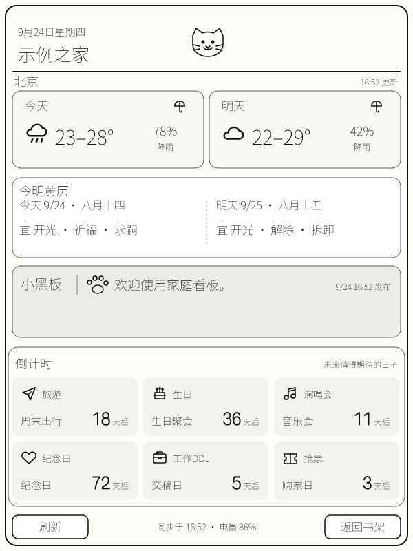

# Kindle Family Dashboard | Kindle 家庭看板

Turn a jailbroken Kindle into a useful, low-power family display, and return to the original bookshelf whenever you want. Configure it from a phone browser; the Kindle shows a 600 x 800 e-ink snapshot with a clock drawn from the device's own system time.

把已越狱的 Kindle 改造成低功耗家庭看板，随时通过屏幕按钮或 KUAL 返回原生书架。用手机网页编辑内容，Kindle 显示 600 x 800 墨水屏快照；时钟使用设备系统时间绘制。

## What it includes | 功能

- Two-day weather and rain probability for a selected city; two-day solar/lunar almanac with suitable activities. / 自选城市的今明天气、降雨概率，以及今明阳历、农历和黄历宜事项。
- One shared blackboard note and up to six editable, categorized countdowns. / 一条共享小黑板消息、最多六条可编辑分类倒计时。
- Two PIN-based editor accounts, one shared display, browser editing, automatic day/night front-light settings. / 两位密码用户共享一台 Kindle，手机网页编辑，前光按设定时段自动调整。
- KPM launcher, KUAL shortcuts, on-screen refresh and bookshelf controls. / KPM 启动入口、KUAL 快捷操作、屏幕刷新和返回书架按钮。
- A local demo that needs no cloud account: `npm ci && npm run check`, then `npx --yes serve dist/site` and open the printed URL with `?demo=1`. / 无需云账号即可先看本地演示。

## Install | 安装

**This is source-to-install, not a universal preconfigured binary.** Each owner generates private CloudBase secrets and a device-specific `.kpkg` locally. No account, PIN, device token or live cloud configuration is included in this repository.

**这是可自行打包安装的源码，不是共用云账号的现成二进制包。** 每位使用者在本地生成私有 CloudBase 密钥和设备专属 `.kpkg`；仓库不含密码、设备令牌或真实云环境配置。

| Language | Complete guide |
| --- | --- |
| English | [Installation and operation](docs/INSTALL.en.md) |
| 中文 | [完整部署与安装步骤](docs/INSTALL.zh-CN.md) |

Tested path: a 600 x 800 jailbroken Kindle with KPM, FBInk, KOReader LuaJIT, USB mass-storage access and Wi-Fi. Other screen sizes and Kindle/KPM versions require adaptation. A Tencent CloudBase environment with Cloud Functions, Cloud Database, Cloud Storage and Static Hosting is required for online use. Node.js 24 is required by the USB installer.

已验证的是 600 x 800 的越狱 Kindle，带 KPM、FBInk、KOReader LuaJIT、USB 磁盘访问和 Wi-Fi。其他屏幕或 Kindle/KPM 版本可能需要适配。联网功能需要腾讯云 CloudBase 云函数、数据库、存储与静态托管；USB 安装脚本需要 Node.js 24。

## Architecture | 架构

`Phone browser -> CloudBase HTTP function -> Cloud Database + Open-Meteo + generated PNG -> Kindle polling script -> FBInk display`

The Kindle polls every five minutes by default and only redraws changed snapshots; its local clock updates independently. Weather is cached for 30 minutes. The dashboard never replaces Kindle books or firmware. The KPM package contains the Kindle-side scripts, not a shared server account.

Kindle 默认每五分钟轮询，只在快照变化时重绘；本地时钟独立更新。天气缓存 30 分钟。项目不会替换书籍或固件。KPM 包包含 Kindle 端脚本，不包含可供所有人共用的服务器账号。

## Security and data | 安全与数据

Use a dedicated CloudBase environment and your own nontrivial PINs. The two PINs are hashed server-side, but four digits are still weak; the editor is intended for a small trusted household. Do not publish generated `cloudbaserc.json`, `.env.local`, `work/`, `dist/` or `dashboard.conf`. They are gitignored, but inspect any archive before sharing it. The CloudBase account may incur charges depending on current quotas; this project does not promise free hosting. Weather uses Open-Meteo; almanac values are calculated by `lunar-javascript`, not issued by an official authority.

建议使用独立 CloudBase 环境与不易猜测的密码。密码在服务端哈希存储，但四位数字仍然较弱，本项目面向可信的少量家庭成员。切勿公开生成的 `cloudbaserc.json`、`.env.local`、`work/`、`dist/` 或 `dashboard.conf`。实际费用取决于腾讯云当前配额，项目不保证免费。天气来自 Open-Meteo；黄历宜事项由 `lunar-javascript` 计算，不代表官方发布。

MIT licensed. Lucide icons retain their own license in `site/assets/icons/LICENSE-lucide.txt`.

Dependency note: `npm audit` currently reports advisories in transitive dependencies of `@cloudbase/node-sdk@3.18.3` (including Axios and Lodash). The upstream SDK currently pins those versions. Review the audit output and deploy only in a dedicated, low-privilege CloudBase environment; do not present this project as security-audited. / 依赖提示：当前腾讯云 Node SDK 的间接依赖在 `npm audit` 中有安全告警。请查看审计结果，使用独立且最小权限的云环境；本项目不宣称已通过安全审计。
